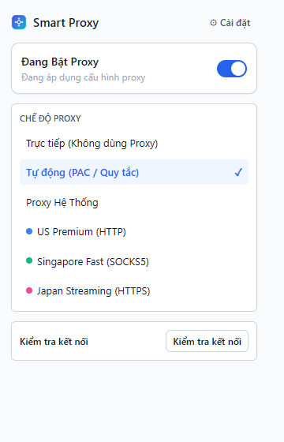
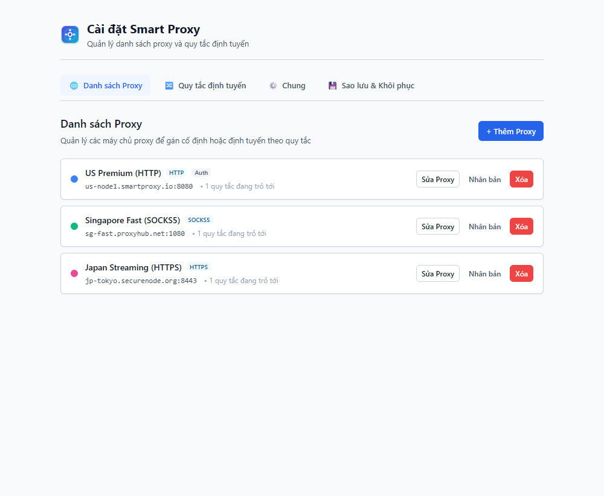
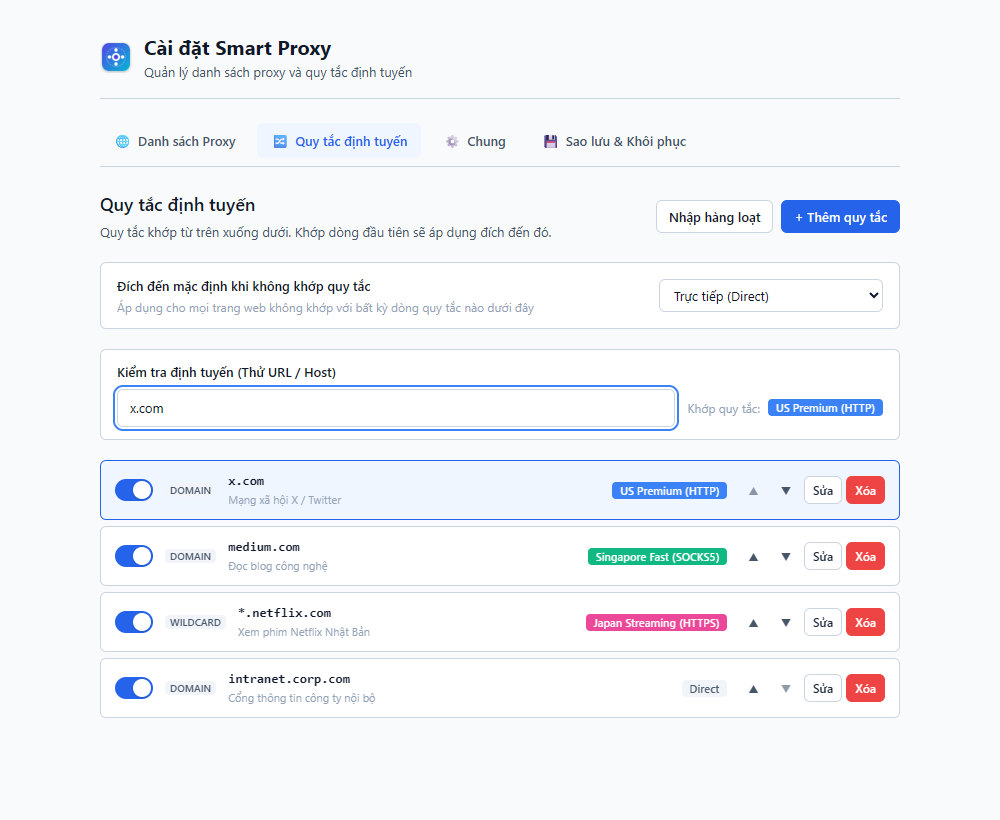
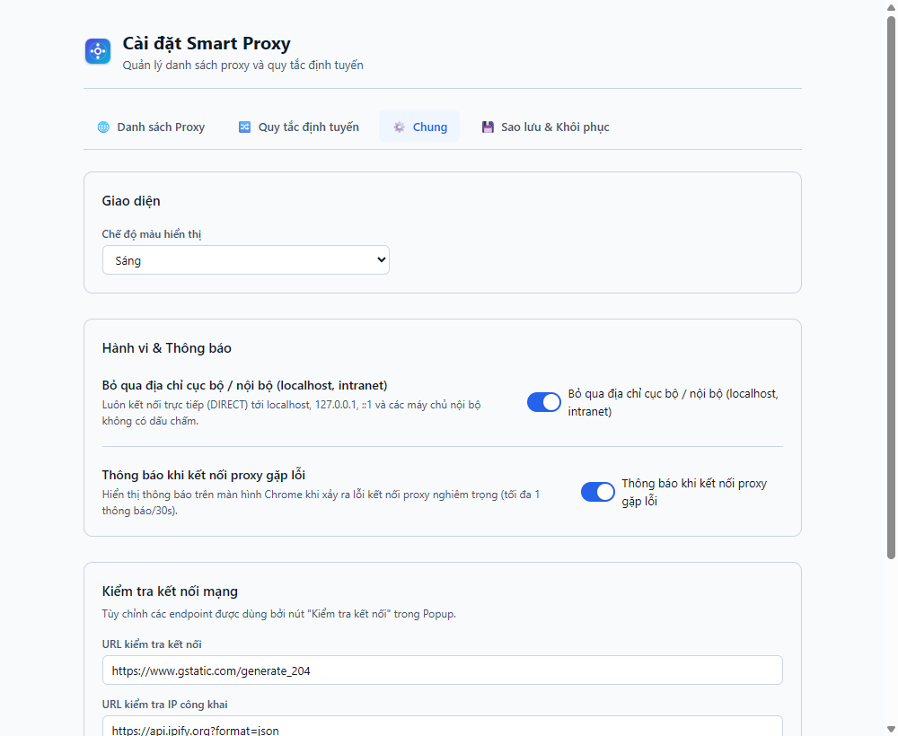
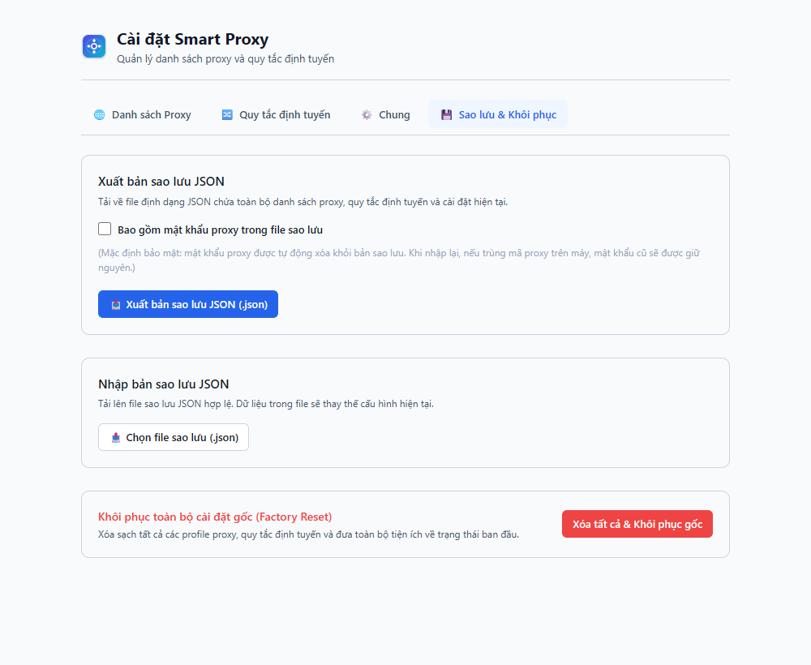

# Cẩm Nang Hướng Dẫn Sử Dụng Smart Proxy 🚀

**Smart Proxy** là tiện ích mở rộng (extension) trên trình duyệt Google Chrome chuẩn **Manifest V3**, giúp bạn quản lý danh sách proxy và tự động hóa định tuyến lưu lượng duyệt web thông minh, bảo mật và tiện lợi chỉ với một cú nhấp chuột hoặc phím tắt.

---

## Mục lục

1. [Cài đặt Tiện ích](#1-cài-đặt-tiện-ích)
2. [Giao diện Popup & Thao tác 1 chạm](#2-giao-diện-popup--thao-tác-1-chạm)
3. [Quản lý Danh sách Proxy (Profiles)](#3-quản-lý-danh-sách-proxy-profiles)
4. [Thiết lập Quy tắc định tuyến thông minh (Routing Rules)](#4-thiết-lập-quy-tắc-định-tuyến-thông-minh-routing-rules)
5. [Cài đặt chung & Phím tắt (General Settings)](#5-cài-đặt-chung--phím-tắt-general-settings)
6. [Sao lưu & Khôi phục Cấu hình (Backup & Restore)](#6-sao-lưu--khôi-phục-cấu-hình-backup--restore)
7. [Giải đáp thắc mắc thường gặp (FAQ)](#7-giải-đáp-thắc-mắc-thường-gặp-faq)

---

## 1. Cài đặt Tiện ích

### Cách 1: Cài đặt từ thư mục mã nguồn (`dist/`)
1. Tải hoặc giải nén thư mục tiện ích vào máy tính (thư mục `dist/`).
2. Mở trình duyệt Google Chrome hoặc trình duyệt nhân Chromium (Edge, Brave, Cốc Cốc...).
3. Truy cập địa chỉ: `chrome://extensions/`.
4. Bật công tắc **Chế độ dành cho nhà phát triển** (**Developer mode**) ở góc trên bên phải.
5. Nhấn nút **Tải tiện ích đã giải nén** (**Load unpacked**).
6. Chọn thư mục `dist/` của Smart Proxy.
7. Ghim biểu tượng Smart Proxy lên thanh công cụ (Toolbar) để tiện thao tác hàng ngày.

### Cách 2: Cài đặt từ file nén ZIP phát hành (`release/smart-proxy-1.0.0.zip`)
1. Giải nén file `smart-proxy-1.0.0.zip` ra một thư mục cố định trên máy.
2. Thực hiện theo các bước từ 2 đến 7 như trên.

---

## 2. Giao diện Popup & Thao tác 1 chạm

Popup là trung tâm điều khiển nhanh khi bạn đang duyệt bất kỳ trang web nào. Bạn có thể mở Popup bằng cách bấm vào biểu tượng extension trên thanh công cụ hoặc bấm tổ hợp phím tắt:
> ⌨️ **Phím tắt mặc định:** `Alt + Shift + P` (Bật / Tắt nhanh proxy)

### Các tính năng chính trên Popup:
1. **Nút Bật/Tắt chính (Master Toggle):**
   - **Đang Bật (Màu xanh lá):** Đang áp dụng proxy theo chế độ bạn chọn.
   - **Đang Tắt (Màu xám):** Lưu lượng truy cập trực tiếp qua mạng thông thường của bạn mà không qua proxy.
2. **4 Chế độ hoạt động linh hoạt:**
   - 🌐 **Tự động (PAC / Quy tắc):** Đề xuất dùng hàng ngày. Tiện ích tự động kiểm tra quy tắc định tuyến; trang nào cần proxy sẽ đi qua proxy, trang nào không cần sẽ vào trực tiếp với tốc độ tối đa.
   - 🔒 **Proxy Cố Định:** Ép toàn bộ lưu lượng của mọi tab đi qua một Profile proxy cụ thể bạn chọn.
   - ⚡ **Trực tiếp (Direct):** Không sử dụng proxy.
   - 🖥️ **Proxy Hệ Thống:** Sử dụng cài đặt proxy của Windows/macOS.
3. **Thông tin Tab hiện tại (Current Tab Routing):**
   - Hiển thị tên miền của trang web bạn đang xem (ví dụ: `x.com`).
   - Cho biết trang web này đang được định tuyến thế nào (ví dụ: `Đang đi qua: US Premium (HTTP)`).
   - Nút thao tác nhanh 1 chạm: **"Luôn trực tiếp"** hoặc **"Đi qua proxy..."** giúp bạn thêm quy tắc định tuyến cho trang đó ngay tại chỗ mà không cần mở trang Cài đặt.
4. **Kiểm tra kết nối thực tế (Test Connection):**
   - Bấm nút **"Kiểm tra kết nối"** để đo độ trễ thực tế (Ping ms) và kiểm tra địa chỉ IP công khai (`Public IP`) hiện tại.
5. **Nhật ký lỗi gần đây (Recent Errors):**
   - Nếu proxy gặp lỗi mạng hoặc bị từ chối kết nối, hệ thống sẽ ghi lại mã lỗi kèm nút "Xóa danh sách lỗi" giúp bạn dễ dàng theo dõi tình trạng mạng.
6. **Nút Cài đặt (⚙️):**
   - Bấm nút cài đặt ở góc trên bên phải để mở trang quản trị chuyên sâu.

---

## 3. Quản lý Danh sách Proxy (Profiles)

Trang **Danh sách Proxy** cho phép bạn thêm, chỉnh sửa và quản lý nhiều proxy từ các nhà cung cấp khác nhau.

### Thêm hoặc Sửa Proxy Profile:
Bấm nút **"+ Thêm Proxy"** để mở biểu mẫu cấu hình:
- **Tên Profile:** Đặt tên gợi nhớ (ví dụ: *US Premium*, *Singapore Game Server*, *Japan Streaming*).
- **Màu nhận diện:** Chọn màu sắc đại diện (xanh dương, xanh lá, hồng, cam...). Màu này sẽ xuất hiện trên huy hiệu (Badge) icon để bạn nhận biết ngay proxy đang dùng.
- **Giao thức (Scheme):** Hỗ trợ đầy đủ các giao thức phổ biến:
  - `HTTP`
  - `HTTPS` (Bảo mật SSL)
  - `SOCKS4`
  - `SOCKS5` (Hỗ trợ định tuyến DNS từ xa an toàn)
- **Máy chủ / IP & Cổng (Host & Port):** Điền địa chỉ IP/domain và cổng tương ứng (ví dụ: `us-node1.smartproxy.io` cổng `8080`).
- **Xác thực (Username & Password):** Nếu proxy yêu cầu tài khoản, bạn nhập tên người dùng và mật khẩu tại đây. Smart Proxy tự động điền thông tin xác thực ngầm qua sự kiện `chrome.webRequest.onAuthRequired` mà không làm phiền bạn bằng popup đăng nhập của trình duyệt.
- **Danh sách bỏ qua (Bypass List):** Các địa chỉ IP hoặc tên miền nội bộ không bao giờ đi qua proxy này (mặc định đã kèm `localhost`, `127.0.0.1`, dải mạng LAN riêng).

---

## 4. Thiết lập Quy tắc định tuyến thông minh (Routing Rules)

Tab **Quy tắc định tuyến** là "trái tim" của Smart Proxy, cho phép bạn tự do quy định website nào đi qua proxy nào, hoặc đi trực tiếp.

### 1. Đích đến mặc định (Default Target)
- Khi một website không khớp với bất kỳ quy tắc nào trong danh sách, tiện ích sẽ gửi lưu lượng đến đích mặc định này (ví dụ: *Trực tiếp (Direct)* hoặc *Proxy Singapore*).

### 2. Công cụ kiểm tra định tuyến (Rule Tester)
- Hộp kiểm tra trực quan ở đầu trang: Bạn chỉ cần gõ bất kỳ tên miền hoặc URL nào (ví dụ: `x.com`, `https://netflix.com/browse`, `10.0.0.1`), hệ thống sẽ phản hồi ngay lập tức website này sẽ được định tuyến đi đâu kèm lý do (*Khớp quy tắc*, *Bỏ qua cục bộ*, hay *Mặc định*).

### 3. Các loại quy tắc (Match Types)
Smart Proxy hỗ trợ 5 phương thức so khớp mạnh mẽ:
1. **Tên miền (Domain / Wildcard):** Khớp tên miền chính và toàn bộ tên miền con (ví dụ: `x.com` khớp cả `api.x.com`, `mobile.x.com`).
2. **Khớp chính xác (Exact Host):** Chỉ áp dụng đúng chính xác tên máy chủ chỉ định (ví dụ: `medium.com` nhưng không áp dụng cho `help.medium.com`).
3. **Mẫu đại diện Wildcard:** Hỗ trợ dấu sao `*` linh hoạt (ví dụ: `*.netflix.com`).
4. **Biểu thức chính quy (Regex):** Dành cho người dùng nâng cao muốn so khớp quy tắc phức tạp (ví dụ: `^internal-(dev|staging)\.corp\.com$`).
5. **Dải mạng con IP (CIDR):** Áp dụng cho các dải mạng IPv4 (ví dụ: `192.168.1.0/24`, `10.0.0.0/8`).

### 4. Nhập hàng loạt (Batch Import)
- Bấm **"Nhập hàng loạt"** để dán danh sách hàng chục tên miền phân cách bởi dòng mới. Tiện ích tự động lọc bỏ tên miền trùng lặp và tạo các quy tắc tương ứng chỉ trong 1 giây.

### 5. Thứ tự ưu tiên & Hoàn tác an toàn (Undo)
- Các quy tắc được đánh giá theo thứ tự từ trên xuống dưới (ưu tiên dòng trên trước). Bạn có thể bấm nút mũi tên **↑** hoặc **↓** để thay đổi độ ưu tiên.
- Khi xóa nhầm một quy tắc, thanh thông báo sẽ hiển thị nút **"Hoàn tác"** trong vòng 5 giây giúp bạn khôi phục lại ngay lập tức.

---

## 5. Cài đặt chung & Phím tắt (General Settings)

Tab **Chung** cung cấp các thiết lập hệ thống để bạn tinh chỉnh trải nghiệm duyệt web.

### Các tùy chọn cấu hình:
- **Ngôn ngữ hiển thị (Language):** Tiếng Việt hoặc English.
- **Xử lý khi mất kết nối (Fallback on Error):** Tự động chuyển về kết nối trực tiếp (Direct) nếu proxy gặp sự cố, đảm bảo trải nghiệm lướt web không bị gián đoạn.
- **Địa chỉ kiểm tra kết nối (Test Latency URL):** Mặc định sử dụng máy chủ chuẩn `https://www.google.com/generate_204` để đo độ trễ chính xác nhất, hoặc bạn có thể thay thế bằng endpoint riêng của mình.
- **Thời gian chờ kết nối (Timeout):** Điều chỉnh thời gian timeout (tính theo giây).
- **Phím tắt tiện ích:**
  - `Alt + Shift + P`: Bật / Tắt nhanh trạng thái proxy.
  - Bạn có thể nhấp vào liên kết phím tắt để mở trang `chrome://extensions/shortcuts` của Chrome và tùy chỉnh lại phím tắt theo sở thích cá nhân.

---

## 6. Sao lưu & Khôi phục Cấu hình (Backup & Restore)

Tab **Sao lưu & Khôi phục** đảm bảo an toàn tuyệt đối cho dữ liệu của bạn, hỗ trợ chuyển đổi cấu hình giữa nhiều máy tính.

### 1. Xuất file cấu hình (Export JSON):
- Bấm nút **"Xuất file cấu hình (JSON)"** để tải về máy toàn bộ danh sách Proxy Profiles, Quy tắc định tuyến và Cài đặt chung. File này được định dạng chuẩn JSON, dễ đọc và lưu trữ an toàn.

### 2. Nhập file cấu hình (Import JSON):
- Bấm **"Chọn tệp cấu hình để nhập"** và chọn file sao lưu từ máy tính.
- Smart Proxy tích hợp bộ kiểm định an toàn nghiêm ngặt (**Schema Validation**). Nếu file không hợp lệ hoặc sai định dạng, tiện ích sẽ từ chối và giữ nguyên cấu hình hiện tại (Rollback) mà không gây lỗi ứng dụng.

### 3. Khôi phục mặc định (Reset to Factory Defaults):
- Khi muốn xóa toàn bộ và đưa tiện ích về trạng thái ban đầu khi mới cài đặt, bấm nút **"Khôi phục mặc định"** và xác nhận.

---

## 7. Giải đáp thắc mắc thường gặp (FAQ)

### Q1: Tiện ích có làm chậm tốc độ mạng khi duyệt các trang thông thường không?
> **Trả lời:** Không! Khi bạn ở chế độ **Tự động (PAC / Rules)**, các trang không nằm trong danh sách quy tắc sẽ truy cập trực tiếp bằng đường truyền mạng thông thường của bạn với tốc độ tối đa 100%.

### Q2: Mật khẩu Proxy của tôi có được bảo mật không?
> **Trả lời:** Hoàn toàn an toàn. Dữ liệu cấu hình được lưu trữ cục bộ trong bộ nhớ an toàn `chrome.storage.local` của trình duyệt trên máy bạn. Smart Proxy **không gửi bất kỳ thông tin nào ra máy chủ bên ngoài**.

### Q3: Tại sao tôi chuyển sang chế độ Proxy nhưng trang web báo lỗi `ERR_PROXY_CONNECTION_FAILED`?
> **Trả lời:** Hãy kiểm tra lại xem máy chủ proxy của bạn có đang online không, thông tin IP/Port và User/Password đã chính xác chưa bằng cách dùng nút **"Kiểm tra kết nối"** trên Popup.

### Q4: Tiện ích có tương thích với các trình duyệt khác không?
> **Trả lời:** Có. Tiện ích hoạt động mượt mà trên tất cả trình duyệt nền Chromium như **Google Chrome**, **Microsoft Edge**, **Brave**, **Cốc Cốc**, **Opera**...

---

*Chúc bạn có trải nghiệm lướt web an toàn, mượt mà và thông minh cùng Smart Proxy!*
